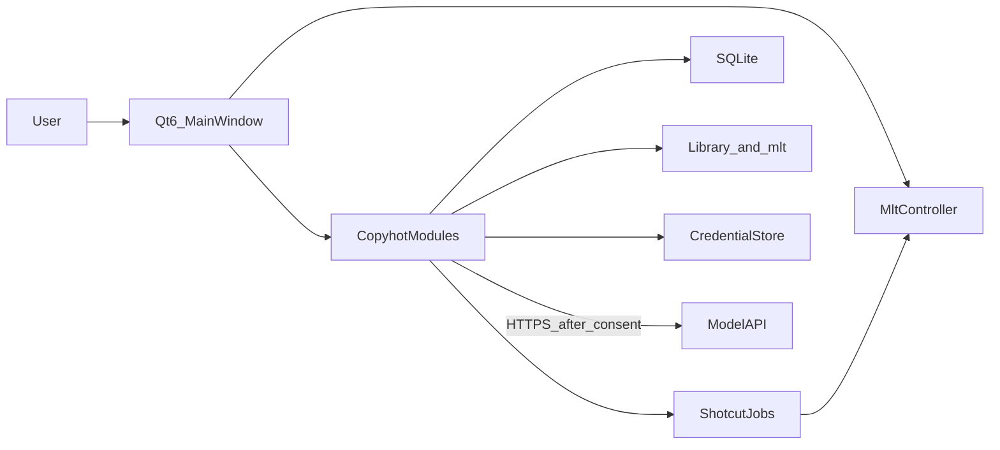
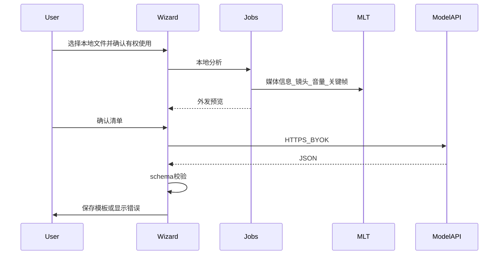

# Copyhot 技术架构设计

状态：启动草案  
日期：2026-11-10  
配套文档：[开发计划](开发计划.md)、[开源合规评估](开源合规评估.md)

本文描述首发桌面客户端的结构。示例 JSON 是协议，不是某个已经存在的接口。上游类名和目录以 Shotcut master 在 2026-11-10 的公开说明为快照；落地时改为选定稳定标签中的实际路径。

## 1. 设计原则

- 本地优先。素材、工程、模板、索引和密钥默认只在用户计算机上。没有业务服务端。
- 剪辑交互不重写。时间线、预览、撤销、代理和导出使用 Shotcut 与 MLT。
- AI 是用户主动触发的旁路。默认关闭。密钥由用户提供，客户端直连用户选择的模型服务。
- 模板与媒体分离。模板是风格和槽位；像素和采样留在用户的文件里。
- 新代码与上游代码隔开，便于按标签合并 Shotcut。

## 2. 总体结构



进程模型：一个 Qt 桌面进程，加上 Shotcut 已有的 MLT 消费者线程和任务。本地转写若启用，是独立的 whisper.cpp 进程，由任务系统拉起，不把转写库链进界面进程。模型请求使用 Qt Network，发往用户填写的 HTTPS 端点。

不引入第二套播放器，也不打包 ffmpeg.wasm 或浏览器剪辑内核。探测、抽帧、转码和导出都走上游已经链接的 MLT / FFmpeg。

## 3. 上游边界

Shotcut（GPL-3.0）是客户端上游，而不是被壳层调用的外部编辑器。编写本文时，上游公开结构如下，实现时以锁定标签为准：

- 构建：CMake。直接依赖包括 Qt 6.4+、MLT++ 7.36.0+、FFTW、FFmpeg、Frei0r、SDL2。上游调试预设还提到 Qt 6.10.3，以标签的 `CMakeLists.txt` 为准。
- `Mlt::Controller`（`MLT`）：打开 producer、consumer、seek 和 profile。
- `MainWindow`（`MAIN`）：停靠面板、布局和撤销栈。`saveXML()` 写出工程。`replaceAllByHash()` 可按媒体标识替换片段。
- `ShotcutActions`：全局 `QAction`。新命令在设置动作时注册。
- 停靠面板在 `src/docks/`，包括 Timeline、Playlist、Encode、Filters、Keyframes、Markers、Subtitles、Jobs、Files、Notes 等。
- 时间线模型是 `MultitrackModel`，素材箱是 `PlaylistModel`。时间线、滤镜、关键帧的视图在 `src/qml/views/`。
- 可撤销操作是 `src/commands/` 中的 `QUndoCommand`。数据流保持：界面动作 → 撤销命令 → 修改 MLT 对象 → 信号 → 模型 → 视图。
- 工程文件是 MLT XML（`.mlt`），不内嵌媒体。路径在工程目录内用相对路径，否则用绝对路径。
- 上游几乎没有 C++ 单元测试。已有的自动化测试是 EDL / 章节导出的 Node 脚本。

Copyhot 在下游树中的新增代码放在 `src/copyhot/`。允许改动上游文件的位置限于：

- `MainWindow` 注册菜单、停靠面板和打开工程后的钩子
- `ShotcutActions` 注册新动作
- 任务基类的子类注册，使分析和理解任务出现在现有 Jobs 面板中，并可取消

不复制一份时间线，也不改 MLT XML 注解的含义。Shotcut 依赖这些注解把 XML 映射回界面，且上游声明它们仍可能变化。生成工程时必须带上当前标签所要求的注解。撰写时至少包括：

- 最终 tractor 的属性 `shotcut=1`
- 时间线轨道 playlist 的 `shotcut:name`，以及 `shotcut:video` 或 `shotcut:audio`
- 用户添加的转场带 `shotcut:transition`，以便和自动混音、合成转场区分
- id 为 `main bin` 的 playlist，以及作为第一条轨道、id 为 `background` 的黑场 playlist
- 自 Shotcut 21.05 起，`avformat` 媒体使用 `chain` 而不是 `producer`；`shotcut:caption`、`shotcut:hash` 等属性同样适用于 `chain`

`shotcut:hash` 的算法与上游一致：小于 2 MB 的文件做全文件 MD5；更大的文件用开头 1 MB 接结尾 1 MB。素材库使用同一算法，这样套用模板和替换镜头可以调用已有的 `replaceAllByHash()`。

## 4. 本机数据

应用配置（窗口布局等）可以继续用 Shotcut 的 `QSettings`。下面这些不放入 `QSettings`：

| 数据 | 位置 |
| --- | --- |
| 模型密钥 | 操作系统凭据库。Windows 使用凭据管理器。键名包含供应商标识，值为密钥。日志打印该值一律打码 |
| 素材索引 | 用户库根目录下的 `copyhot.sqlite`。换目录即换库 |
| 缩略图与分析用关键帧 | 库根目录下的缓存子目录，可删除重建 |
| 代理文件 | 沿用 Shotcut 代理目录规则 |
| 模板 | 库根目录下的 `templates/*.json` |
| 成片工程 | 用户选择的 Shotcut 工程目录中的 `.mlt`。同目录写入 `copyhot-template.json`，记录套用的模板和槽位绑定，不写媒体字节 |

素材文件本身保持用户放入库中的路径。数据库保存绝对路径。路径失效时标记缺失，不自动扫描全盘。

建议的逻辑表：

- `assets`：id、path、hash、kind（video / image / audio）、duration_ms、width、height、thumb_path、added_at
- `tags`：asset_id、tag、source（user 或 ai）
- `insights`：asset_id、provider、model、summary、payload_json、created_at
- 模板以文件为准，不把模板正文再存一份进数据库。需要列表时扫描 `templates/`。

SQLite 使用 FTS5 索引路径、文件名、标签和 summary。没有单独的搜索服务。

## 5. 模板

模板 schema 名为 `copyhot.template.v1`。时间用秒，生成工程时按 profile 的帧率换成 MLT 的帧。槽位是待绑定的素材角色，不是文件路径。

```json
{
  "schema": "copyhot.template.v1",
  "name": "快节奏口播",
  "profile": { "width": 1080, "height": 1920, "fps": 30 },
  "rhythm": { "avgShotSec": 1.2, "shotDurationSec": [0.8, 1.1, 1.6] },
  "tracks": [
    {
      "role": "video",
      "clips": [
        { "slot": "voice", "durationSec": 1.6, "fit": "cover" }
      ]
    },
    {
      "role": "audio-bgm",
      "clips": [{ "slot": "bgm", "gainDb": -14, "durationSec": 12.0 }]
    }
  ],
  "captions": {
    "items": [{ "startSec": 0.2, "endSec": 1.6, "textRole": "hook" }],
    "style": { "placement": "bottom", "weight": "bold" }
  },
  "transitions": [{ "between": [0, 1], "type": "dissolve", "durationSec": 0.2 }]
}
```

约束：

- 不允许字段携带图像、PCM、参考片路径或字幕原文。字幕只保留角色和时间，文案在套用时来自用户素材的理解结果或用户输入。
- `type` 必须落在一张内部对照表上，映射到当前 Shotcut 标签里真实存在的 `shotcut:transition` / 滤镜标识。对照表随标签更新，未知类型降级为硬切。
- 保存前用 JSON Schema 校验。失败的响应只留在向导的错误页，不写文件。

套用时另存一份绑定记录（仍是 JSON）：每个 `slot` 对应 `assets.id`。生成器读取绑定，用 MLT API 创建 chain、playlist 和 tractor，写上第 3 节的注解，再调用现有打开工程路径。这样界面模型与手写 XML 的分叉只发生在一处。

字幕优先走上游 `SubtitlesDock` 使用的字幕数据，而不是把字烧进画面滤镜。只有该标签没有可程序化写入的字幕轨时，才退化为文本滤镜，并在架构文档的修订记录里说明。

## 6. 三条链路

### 6.1 参考片到模板



本地分析放在 Shotcut 任务子系统中，以便占用 Jobs 面板、支持取消，并避免堵住界面线程。镜头切分使用上游 FFmpeg 的场景检测滤镜。不引入 Python 运行时，因此不把 PySceneDetect 列为首发依赖。

音量只用数值特征（例如短时能量或响度统计）。特征提取失败时，模板的 BGM 槽位仍可生成，增益用默认值，并向用户说明节奏来自镜头时长而不是音频。

本地转写是可选项，进程为 whisper.cpp（MIT）。未安装或用户未打开时，外发清单中的「转写文本」为空，且不能被默认勾上。

### 6.2 素材理解

导入只做哈希、缩略图和媒体信息。用户对一条或一批素材执行「理解」时，才读取凭据库中的密钥。批量任务逐条展示或汇总展示外发字段，取消则停在下一跳之前。

理解结果写入 `tags` 与 `insights`。同一素材可以有多次记录，检索默认用最新一次成功结果。

### 6.3 套用、微调与导出

绑定完成前不创建 `.mlt`。生成后的微调全部走上游命令（修剪、分割、移动、音量、字幕编辑、转场）。Copyhot 不平行维护一份时间线状态。

导出使用 Encode 面板现有的任务。额外一步：若显式标识开关开启（默认开启），在导出文件或包装步骤加上可见的「AI 生成」标识。标识的具体画幅位置在 M4 实现时定一种默认（成片角落、短时出现），并允许用户关闭。关闭状态写入该次导出的本地日志，日志不含密钥和提示词。

## 7. BYOK 与外发范围

设置项：供应商预设、Base URL、模型名。密钥只有写入和清除，界面不回显全文。连接测试使用供应商的最小请求（例如模型列表或一条固定的无素材提示），测试包不附带用户素材。

客户端直接请求该 Base URL。不经 Copyhot 的服务器，也没有嵌入的默认密钥。预设只保存公开的 URL 和模型名，可以包括 OpenAI 兼容服务，以便使用通义、豆包、智谱、DeepSeek 等由用户自行开通的接口。某个预设是否真能看图，由测试请求和文档中的能力标记决定，失败时向导停在本地结果，不静默降级成上传整文件。

每次调用前的确认页列出下表中的实际项。范围比上次同意更大时（例如从「不发送画面」改为发送关键帧，或打开深度模式），必须重新确认。

| 数据 | 默认 | 何时离开本机 |
| --- | --- | --- |
| 时长、分辨率、帧率、镜头时长、音量统计 | 分析流程会发送 | 用户确认该次分析或理解 |
| 低分辨率关键帧 | 关闭，需单独勾选 | 勾选并确认后 |
| 本地转写文本 | 仅当用户已生成本地转写且勾选 | 勾选并确认后 |
| 文件名 | 默认不发送，改为「素材 1」这类序号 | 用户勾选「包含文件名」 |
| 整文件或长视频 | 关闭 | 深度模式单独勾选 |
| 密钥 | 作为该请求的认证头 | 每次请求发往用户填写的主机，不写入磁盘日志 |
| 素材库批量正文 | 不发送 | 不对整个库做一次打包上传 |

确认页同时说明：Copyhot 不保存请求正文；模型供应商是否保留，由其政策决定，并提供用户填写的政策链接。人脸出现在关键帧中时，视为敏感个人信息，没有「发送画面」的单独同意就不发送图像。

日志、崩溃转储和任务错误信息在落盘前去掉 `Authorization` 头、请求体和本地绝对路径。首发没有内容遥测。

## 8. 错误行为

- Schema 不符、HTTP 非成功、用户取消：不写模板、不写标签。本地分析缓存可以保留，便于重试且不再抽帧。
- 密钥缺失或 Base URL 为空：AI 动作不可用，素材库和剪辑仍可用。
- 生成 `.mlt` 时转场标识在当前标签不存在：该切点改为硬切，并在向导里列出降级项。
- 绑定的素材路径缺失：不生成工程，标出缺失条目。

## 9. 仓库形态

M0 验证通过后，应用源码以选定 Shotcut 标签为基线放入本仓库（或以可复现的方式固定该提交），上游远程和标签写在架构文档的修订记录中。GPL-3.0 许可证文本与上游 `COPYING` 的保留要求在引入代码的同一次提交完成，不在只有文档时声称仓库已经满足源码分发义务。
